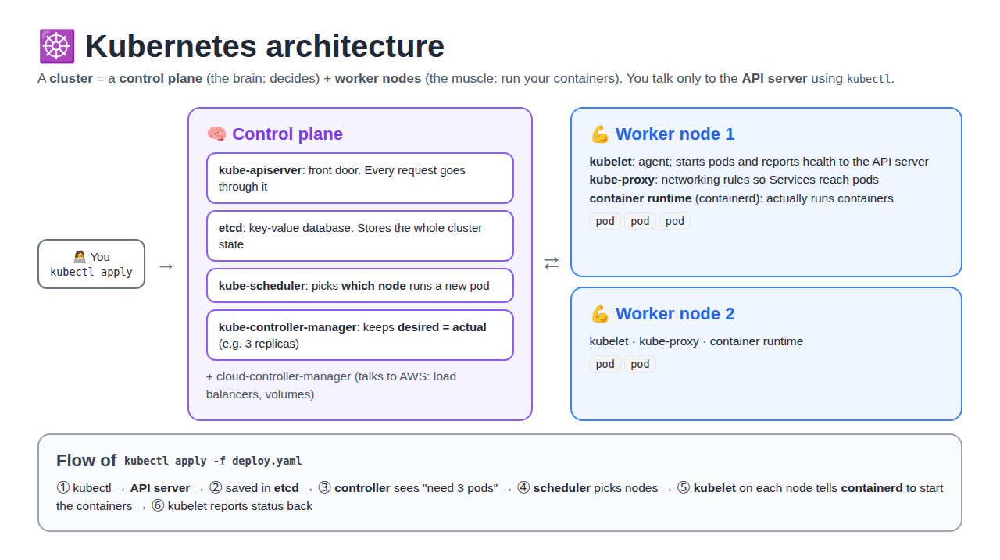

# Kubernetes Introduction: What and Why, Real-Time Use, EKS Cluster Creation and Architecture

[← Kubernetes from scratch](../README.md)

> **In short:** Docker runs containers on **one** machine. **Kubernetes** runs and manages containers across **many** machines: it restarts them when they crash, scales them, spreads them across servers, and updates them with zero downtime. You tell it **what you want** (YAML) and it keeps it that way. On AWS we use **EKS**, where AWS runs the control plane and we run the worker nodes.

## Table of Contents

1. [What is Kubernetes?](#1-what-is-kubernetes)
2. [Why Kubernetes? (problems with only Docker)](#2-why-kubernetes-problems-with-only-docker)
3. [Kubernetes in Real Time](#3-kubernetes-in-real-time)
4. [EKS Cluster Creation (Manual, Console)](#4-eks-cluster-creation-manual-console)
5. [Kubernetes Architecture](#5-kubernetes-architecture)
6. [Commands](#6-commands)
7. [Interview Questions](#7-interview-questions)

---

## 1. What is Kubernetes?

**Definition:** Kubernetes (**K8s**) is an open-source **container orchestration** platform. It automatically **deploys, scales, heals and manages** containers across a group of servers (a **cluster**).

- **K8s** = K + 8 letters + s
- Built by **Google** (from its internal system Borg), now run by the **CNCF**
- **Orchestration** = managing many containers together, like a conductor managing an orchestra

| Word | Simple meaning |
|---|---|
| **Container** | App + everything it needs, packed together (Docker image running) |
| **Cluster** | A group of machines Kubernetes manages as one |
| **Node** | One machine (EC2 / VM) in the cluster |
| **Pod** | The smallest unit in K8s: wraps 1+ containers |
| **Desired state** | What you ask for in YAML, e.g. "3 copies of nginx" |
| **Actual state** | What is really running right now |

**Key idea: desired state.** You write *"I want 3 nginx pods"*. Kubernetes checks all the time: if only 2 run, it starts 1 more. You say **what**, K8s handles **how**.

---

## 2. Why Kubernetes? (problems with only Docker)

> **In short (say this in interviews):** Kubernetes orchestrates containers by scheduling them across nodes, scaling them, restarting failed ones, handling service discovery, and performing rolling updates. Amazon EKS is AWS's managed Kubernetes service. AWS runs and patches the control plane, so your team doesn't operate the API server or etcd. EKS also integrates with IAM, VPC networking, and load balancers, which reduces operational burden.

**Docker alone** is great on one server. In production with many containers and servers, these problems appear:

| Problem with only Docker | What Kubernetes does |
|---|---|
| Container crashes at 2 AM → stays down until someone restarts it | **Self-healing:** restarts / replaces it automatically |
| Traffic spikes (sale day) → you add containers by hand | **Auto-scaling:** adds pods when CPU is high (HPA) |
| Server dies → all its containers die | **Reschedules** the pods on healthy nodes |
| Which server has free CPU/RAM? You decide by hand | **Scheduler** places pods on the best node |
| New version → stop old, start new → **downtime** | **Rolling update:** replaces pods one by one, no downtime |
| Bad release → manual fix | **Rollback** with one command |
| Containers' IPs keep changing → how to find them? | **Service** gives a fixed name/IP + load balancing |
| Passwords in the image / env files | **Secrets & ConfigMaps** |

> **One line:** Docker **builds and runs** containers; Kubernetes **manages** them at scale (heal, scale, update, network).

### What Kubernetes does (5 jobs)

Kubernetes **orchestrates** containers. It does five main jobs:

| Job | Meaning |
|---|---|
| **Scheduling** | Places containers on the right nodes |
| **Scaling** | Adds or removes copies as load changes |
| **Self-healing** | Restarts failed containers |
| **Service discovery** | Lets services find each other by name |
| **Rolling updates** | Releases a new version with no downtime |

### Why Amazon EKS?

**Definition:** **Amazon EKS** (Elastic Kubernetes Service) is AWS's **managed Kubernetes** service.

**Main benefit:** AWS runs and patches the **control plane**, so your team doesn't run the **API server** or **etcd**.

| | Self-managed K8s (on EC2) | Amazon EKS |
|---|---|---|
| Control plane (API server, etcd) | **You** install, patch, back up | **AWS** runs and patches it |
| Worker nodes | You | You (or managed node groups / Fargate) |
| Access / auth | Set up yourself | Built-in **IAM** integration |
| Networking | Set up yourself | **VPC** networking (pods get VPC IPs) |
| Load balancers | Set up yourself | Works with AWS **ALB / NLB** |
| Ops effort | High | **Lower** |

```
           Amazon EKS
┌───────────────────────────────┐
│  Control plane  (AWS manages) │  API server · etcd · scheduler
└───────────────┬───────────────┘
                │
┌───────────────▼───────────────┐
│  Worker nodes   (you manage)  │  EC2 / Fargate → your pods
└───────────────────────────────┘
   + IAM · VPC · ALB/NLB integration
```

---

## 3. Kubernetes in Real Time

**Where it's used:** almost every company running microservices: Netflix, Spotify, Swiggy, Zomato, banks, SaaS products.

**Real example: my RoboShop project**

RoboShop is a microservices **e-commerce app** (an online shop) that I built on AWS: first by hand, then with [shell scripts](https://github.com/Abhignadumpala/devops-notes/tree/main/day-16-roboshop-shell-scripts), then with [Ansible](https://github.com/Abhignadumpala/devops-notes/tree/main/day-22-ansible-shell-vs-ansible-aws-ec2-route53/roboshop-v1). There, every service ran on its **own EC2 server**. On Kubernetes, the same services become:

```
Frontend · Catalogue · Cart · User · Payment · Shipping   → each is a Deployment + Service
MongoDB · Redis · MySQL · RabbitMQ                         → databases / queues (StatefulSets or AWS managed services)
```

> Full story of how I built it: [RoboShop Journey](https://github.com/Abhignadumpala/devops-notes/tree/main/roboshop-journey).

| Real situation | Kubernetes feature |
|---|---|
| Lunch time traffic 10x | HPA scales `cart` from 3 → 15 pods, back to 3 after |
| `payment` pod crashes | ReplicaSet creates a new pod in seconds |
| Release v2 of `catalogue` at 3 PM | Deployment rolling update, users don't notice |
| v2 has a bug | `kubectl rollout undo` → back to v1 in a minute |
| One EC2 node dies | Pods moved to other nodes automatically |

**Managed Kubernetes (used in real jobs):** you don't build the control plane yourself.

| Cloud | Service |
|---|---|
| AWS | **EKS** (Elastic Kubernetes Service) |
| Azure | AKS |
| Google Cloud | GKE |

Local practice: **minikube**, **kind**, **k3s**.

---

## 4. EKS Cluster Creation (Manual, Console)

**Definition:** The settings you pick when you create an EKS cluster: Kubernetes version, support type, observability, add-ons and worker nodes.

**EKS creation: manual console vs Terraform**

| | Manual (AWS console) | Terraform |
|---|---|---|
| How | Click through the EKS screens in the browser | Write the cluster as code with **Terraform modules** (e.g. `terraform-aws-modules/eks/aws`) and run `terraform apply` |
| Repeatable | ❌ Every click must be done again for each cluster | ✅ Same code creates the same cluster every time |
| Reviewed | ❌ No record of who changed what | ✅ Changes go through Git and pull requests |
| Environments | ❌ dev / test / prod drift apart | ✅ dev, test and prod are built from the same code |
| Use for | Learning what each setting means | ✅ **Real projects** |

> **Real time:** below we walk through the settings in the **console**, to understand what each one does. Real projects create the cluster with **Terraform**: see [EKS with Terraform](../03-eks-cluster-with-terraform/README.md).

### 1. Kubernetes version: upgrade policy

| Option | Support period | Cost | Real time |
|---|---|---|---|
| **Standard support** ✅ | **14 months** after the version is released on EKS | Normal price | **We choose this** and upgrade on time |
| **Extended support** | 12 more months (26 in total) | Extra hourly charge per cluster | Only if you can't upgrade in time |

> After standard support ends, a cluster on **extended** keeps running the old version but costs more. On **standard**, AWS auto-upgrades the control plane to the next version. So plan upgrades before the 14 months end.

### 2. Control plane configuration

A newer option: you pick a **control plane size/tier**. Default (standard) scales automatically; bigger tiers are for very large or busy clusters. AWS still runs it either way.

### 3. Observability: metrics

| Option | What it is | We chose |
|---|---|---|
| **Amazon CloudWatch** | AWS's own monitoring service | |
| **Prometheus** | Open-source metrics tool (Amazon Managed Service for Prometheus scrapes the cluster) | ✅ |
| **Network monitoring** | Shows traffic between pods, nodes and AWS services | ✅ enabled |

### 4. Add-ons to install

**Definition:** An **add-on** is extra software EKS installs and updates for you to give the cluster key features (networking, DNS, storage, metrics).

| Add-on | What it does | Needed? |
|---|---|---|
| **Amazon VPC CNI** | Gives each pod an IP from your VPC (pod networking) | ✅ Must (default) |
| **kube-proxy** | Network rules on each node so Services route traffic to pods | ✅ Must (default) |
| **CoreDNS** | DNS inside the cluster: `cart` → pod IP (service discovery) | ✅ Must (default) |
| **EKS Pod Identity Agent** | Lets pods get IAM permissions (e.g. EBS driver, S3 access) | ✅ Recommended |
| **Amazon EBS CSI Driver** | Creates **EBS volumes** for pods that need storage (databases) | ✅ If you store data |
| **Metrics Server** | CPU/RAM usage of pods and nodes → needed for `kubectl top` and **HPA** auto-scaling | ✅ |
| **Prometheus Node Exporter** | Exports node metrics (CPU, memory, disk, network) for Prometheus | ✅ With Prometheus |
| **Network Flow Monitor agent** | Collects network data for network monitoring | If network monitoring is on |

```
            EKS cluster add-ons
Networking  → VPC CNI · kube-proxy · CoreDNS
Security    → Pod Identity Agent
Storage     → EBS CSI Driver
Metrics     → Metrics Server · Node Exporter · (Prometheus)
```

### 5. Worker nodes: who creates them?

**Definition:** **Worker nodes** are the EC2 machines where your pods run.

| Option | Who creates and manages nodes | How |
|---|---|---|
| **EKS Auto Mode** | **AWS**: nodes are created **automatically** when pods need them, and removed when not needed | Turn on Auto Mode when creating the cluster |
| **Managed node group** | **You** choose instance type, size, min/max count; AWS helps with launch and updates | Cluster → **Compute** tab → **Node groups** → **Add node group** |
| **Fargate** | AWS, serverless: no EC2 to see, each pod runs on its own | Create a Fargate profile |

> **Simple rule:** With Auto Mode, AWS creates the nodes for you. If you want to create the worker nodes yourself, go to **Node groups** and create one.

> **Interview one-liner:** I pick **standard support** (14 months) and upgrade on time. The must-have add-ons are **VPC CNI, kube-proxy and CoreDNS**. I add the **EBS CSI driver** for storage, **Metrics Server** for HPA, and **Node Exporter** for Prometheus. Nodes come from **Auto Mode** (AWS creates them) or **node groups** (we create them). In real projects the cluster is created with **Terraform modules**, not the console.

---

## 5. Kubernetes Architecture

**Definition:** a cluster has 2 parts: the **control plane** (the brain that **decides**) and **worker nodes** (the muscle that **runs** your pods).



### Control plane (master) components

| Component | Simple job | Analogy |
|---|---|---|
| **kube-apiserver** | Front door. Every request (kubectl, nodes, controllers) goes through it | Reception desk |
| **etcd** | Key-value database storing the **whole cluster state** | The company register |
| **kube-scheduler** | Decides **which node** a new pod runs on (free CPU/RAM, rules) | HR assigning desks |
| **kube-controller-manager** | Runs controllers that keep **desired = actual** (ReplicaSet, Node, Deployment controllers) | Manager checking "do we have 3 people on shift?" |
| **cloud-controller-manager** | Talks to the cloud (AWS load balancers, volumes, nodes) | Contact with the landlord |

### Worker node components

| Component | Simple job |
|---|---|
| **kubelet** | Agent on every node. Gets pod specs from the API server, starts them, reports health |
| **kube-proxy** | Network rules on each node so **Services** can reach the right pods |
| **Container runtime** | Actually runs containers: **containerd** (or CRI-O). Docker images still work |

### What happens on `kubectl apply -f deploy.yaml`

```
1. kubectl          → sends YAML to the API server
2. API server       → validates it, saves it in etcd
3. Controller       → sees "Deployment wants 3 pods, 0 exist" → creates 3 pod objects
4. Scheduler        → picks a node for each pod
5. kubelet (node)   → tells containerd to pull the image and start the containers
6. kubelet          → reports "Running" back to the API server
```

> **Remember:** only the **API server** talks to **etcd**. Everything else talks to the API server.

> **On EKS:** AWS runs and manages the whole control plane for you; you manage only the worker nodes (or use Fargate).

---

## 6. Commands

| Command | Use |
|---|---|
| `aws eks update-kubeconfig --region <region> --name <cluster>` | Connect kubectl to an EKS cluster |
| `kubectl version` | Client and server (cluster) versions |
| `kubectl cluster-info` | API server address |
| `kubectl get nodes -o wide` | Worker nodes, their IPs and versions |
| `kubectl get pods -n kube-system` | System Pods: CoreDNS, kube-proxy, aws-node (CNI) |

---

## 7. Interview Questions

### Other Questions

**Q1. What is Kubernetes?**
An open-source container orchestration platform that deploys, scales, heals and manages containers across a cluster.

**Q2. Why Kubernetes if we have Docker?**
Docker runs containers on one machine. Kubernetes manages them across many machines: self-healing, auto-scaling, rolling updates, rollback, service discovery.

**Q3. Explain Kubernetes architecture.**
Control plane: API server (front door), etcd (state database), scheduler (picks a node), controller manager (keeps desired = actual). Worker nodes: kubelet (runs pods), kube-proxy (networking), container runtime (containerd).

**Q4. What is etcd?**
A key-value database that stores the entire cluster state. Only the API server talks to it. Back it up.

**Q5. What does the scheduler do?**
Chooses which node a new pod runs on, based on free resources and rules.

**Q6. What is EKS?**
AWS-managed Kubernetes: AWS runs the control plane, you run (or let Fargate run) the worker nodes.

**Q7. EKS standard vs extended support?**
Standard = 14 months of support per version at normal price. Extended = 12 more months at extra cost. Use standard and upgrade on time.

**Q8. Which add-ons does an EKS cluster need?**
Must: VPC CNI, kube-proxy, CoreDNS. Common extras: EKS Pod Identity Agent, EBS CSI driver (storage), Metrics Server (HPA), Prometheus Node Exporter (node metrics).

**Q9. Why is HPA not scaling? (`kubectl top` shows an error)**
Metrics Server is not installed. HPA needs it to read pod CPU/RAM.

**Q10. How do you create an EKS cluster in real projects?**
With Terraform modules (infrastructure as code), not the console, so it is repeatable and reviewed in Git.

**Q11. EKS Auto Mode vs managed node group?**
Auto Mode: AWS creates, scales and manages the worker nodes automatically. Managed node group: you choose the instance type and min/max count (Compute → Node groups → Add node group).

---

**Source:** [Kubernetes docs: components](https://kubernetes.io/docs/concepts/overview/components/) · [EKS version support](https://docs.aws.amazon.com/eks/latest/userguide/kubernetes-versions.html) · [EKS add-ons](https://docs.aws.amazon.com/eks/latest/userguide/eks-add-ons.html)
