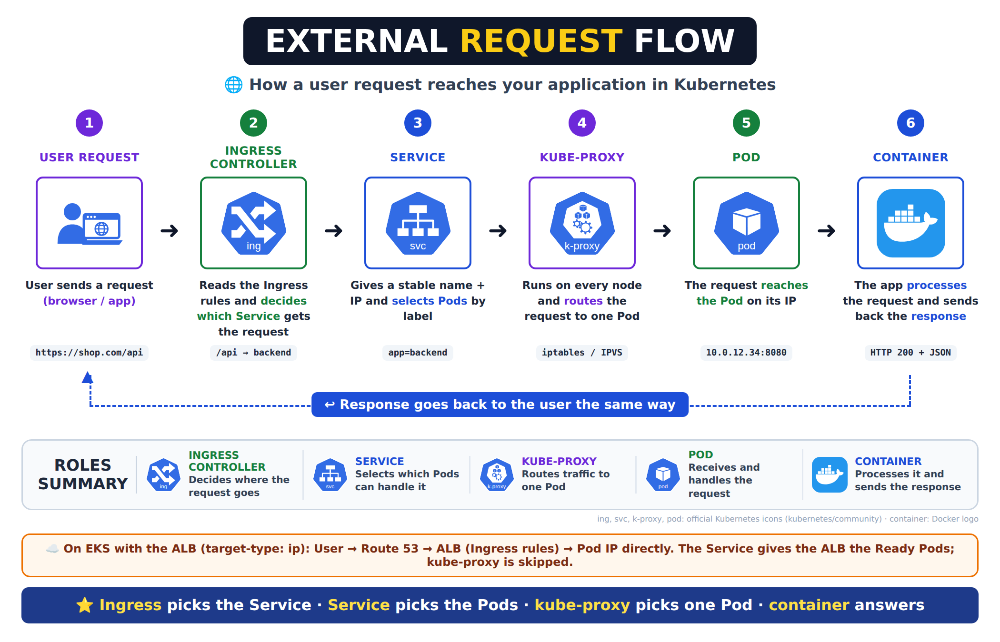

# Kubernetes Ingress: Why We Need It, Ingress Controllers, Rules and How Requests Reach the Pod

[← Kubernetes from scratch](../README.md)

> **In short:** Exposing every app with its own **LoadBalancer** Service gets expensive and messy. An **Ingress** is a set of HTTP/HTTPS **routing rules** (by host and path), and an **Ingress controller** makes them real. On EKS that's the **AWS Load Balancer Controller**, which turns each Ingress into **one ALB** that serves many apps and sends traffic straight to the Ready Pods.

## About this topic

| Part | Topic | What you learn |
|---|---|---|
| **Part 1: Concepts** | Why Ingress, Ingress, Ingress controller, request flow, sample, Service type vs Ingress (RoboShop example), rules | What each piece is, how a request reaches the Pod, how to write host and path rules |
| **Part 2: Lab** | Two apps behind one ALB on EKS | Create an Ingress with host rules and test it |

> Related: Services (ClusterIP, NodePort, LoadBalancer) are in [Services](../08-services/README.md).

## Table of Contents

**Part 1: Concepts**

1. [Why we need Ingress](#1-why-we-need-ingress)
2. [What is Ingress?](#2-what-is-ingress)
3. [What is an Ingress controller?](#3-what-is-an-ingress-controller)
4. [How a user request reaches the Pod](#4-how-a-user-request-reaches-the-pod)
5. [Sample Ingress (ALB on EKS)](#5-sample-ingress-alb-on-eks)
6. [Where does the load balancer come from? (Service type vs Ingress)](#6-where-does-the-load-balancer-come-from-service-type-vs-ingress)
   - [6.1 Which Service type do I write?](#61-which-service-type-do-i-write)
   - [6.2 How the ALB is created without `type: LoadBalancer`](#62-how-the-alb-is-created-without-type-loadbalancer)
   - [6.3 Ingress is an object, not a Service](#63-ingress-is-an-object-not-a-service)
   - [6.4 RoboShop example: everything ClusterIP, one Ingress](#64-roboshop-example-everything-clusterip-one-ingress)
7. [Ingress rules](#7-ingress-rules)
   - [7.1 Parts of a rule](#71-parts-of-a-rule)
   - [7.2 pathType](#72-pathtype)
   - [7.3 Host-based routing](#73-host-based-routing)
   - [7.4 Path-based routing](#74-path-based-routing)
   - [7.5 Rewrite: removing the prefix (NGINX controller)](#75-rewrite-removing-the-prefix-nginx-controller)
   - [7.6 Default backend and HTTPS](#76-default-backend-and-https)
   - [7.7 Host or path: which one?](#77-host-or-path-which-one)

**Part 2: Lab**

8. [Lab: two apps behind one ALB](#8-lab-two-apps-behind-one-alb)

**Wrap-up**

9. [What I learned](#9-what-i-learned)
10. [Commands](#10-commands)
11. [Interview Questions](#11-interview-questions)

---

# Part 1: Concepts

## 1. Why we need Ingress

When you first deploy applications in Kubernetes, you typically expose them using **NodePort** or **LoadBalancer** Services. But as your architecture grows, managing **dozens of LoadBalancers** quickly becomes **inefficient and expensive**.

That's where **Ingress** and **Ingress controllers** come in, offering **smarter routing**, **central management**, and **flexible control** over external HTTP/S traffic.

| | One LoadBalancer Service per app | Ingress |
|---|---|---|
| Load balancers for 10 apps | **10** (10 bills, 10 DNS names) | **1** shared ALB |
| Routing | None: one load balancer = one app | By **host** (`api.shop.com`) and **path** (`/api`) |
| HTTPS certificates | Set up on every load balancer | In **one place** |
| Adding a new app | Another load balancer | Add a rule to the Ingress |

### Problems Ingress solves

**1. Services only do basic load balancing.** A Service spreads connections across its Pods, and that's all. It knows nothing about URLs, domains or HTTPS. Real websites need more:

| Feature | What it means | Service alone | With Ingress |
|---|---|---|---|
| **Path-based routing** | `/products` → product service, `/users` → user service | ❌ | ✅ |
| **Host-based routing** | `shop.com` → frontend, `api.shop.com` → api | ❌ | ✅ |
| **TLS termination** | HTTPS ends at the front door, so the apps don't each handle certificates | ❌ | ✅ |
| **Sticky sessions** | A user keeps going to the **same Pod** for their session (e.g. a cart kept in memory) | Only by client IP (`sessionAffinity: ClientIP`) | ✅ Cookie-based (on the ALB: `alb.ingress.kubernetes.io/target-group-attributes: stickiness.enabled=true`) |

**2. One LoadBalancer per Service costs too much.** Every LoadBalancer Service creates its **own** cloud load balancer, each billed per hour with its own public IP addresses. 10 apps = 10 load balancers; 100 microservices = 100. With Ingress they share **one**.

**3. Ingress is not one-to-one with Services.** A single Ingress can route to **many** Services (`/a` → service 1, `/b` → service 2), so adding an app means adding a rule, not a new load balancer.

---

## 2. What is Ingress?

**Definition:** an **Ingress** is an API object in Kubernetes that manages **external access to Services** inside the cluster. It defines **HTTP and HTTPS routing rules** that send each request to the correct Service based on the request's **host** (`admin.shop.com`) or **path** (`/api`). This lets **many apps share one public load balancer**; on EKS that load balancer is an **ALB** (Application Load Balancer).

> **In simple terms:** Ingress is your app's **front door**, deciding where traffic goes.

| Term | Meaning |
|---|---|
| **North-south traffic** | Traffic coming **into** the cluster from outside (users → apps). This is what Ingress handles |
| **East-west traffic** | Traffic **between** Pods inside the cluster (frontend → backend). Handled by Services, not Ingress |

> 💡 An Ingress is just YAML, so it lives in **Git** next to the app's manifests and is deployed by **CI/CD / Argo CD** like everything else. A new route = a reviewed pull request.

```
 shop.com/api  → backend
 shop.com/     → frontend
```

> 🛎️ **Example:** **one main reception for the whole company**. The receptionist asks "which department?" and sends you there.

### Key features of Ingress

| Feature | Example |
|---|---|
| **Path-based routing** | `/api` → backend, `/login` → auth |
| **Host-based routing** | `app.example.com` → frontend, `shop.example.com` → shop |
| **SSL/TLS termination** | HTTPS ends at the load balancer with one certificate (ACM on AWS) |
| **Load balancing** | Requests are spread across the Ready Pods of each Service |
| **Extras (via the controller)** | Authentication, rate limiting, redirects, WAF |

---

## 3. What is an Ingress controller?

**Definition:** an **Ingress controller** is the **actual implementation** that makes Ingress work. It runs as Pods in the cluster, **watches for Ingress resources**, and sets up the routing they describe: either by configuring itself as a proxy (NGINX, Traefik) or by creating a cloud load balancer (AWS ALB).

> **In simple terms:** the controller is the **traffic cop** that enforces the rules written in your Ingress YAML.

> ⚠️ **Without an Ingress controller, your Ingress resources won't work.** They're just definitions until a controller reads them and acts on them. `kubectl get ingress` would show no `ADDRESS`:

```
NAME   CLASS   HOSTS         ADDRESS   PORTS   AGE
shop   alb     shop.com                80      49s     ← empty: no controller has picked it up
```

Once a controller is installed and reads the Ingress, `ADDRESS` fills in (on EKS: the ALB's DNS name) and requests start working.

| Piece | What it is | Who makes it |
|---|---|---|
| **Ingress** | The rules (YAML) | You, with `kubectl apply` |
| **Ingress controller** (on EKS: **AWS Load Balancer Controller**) | Pods in `kube-system` that read the rules | You install it **once** per cluster (Helm) |
| **ALB** (Application Load Balancer) | The **real door**: receives users, applies the rules, sends to Pods | The controller creates it **automatically** |

> 🛎️ The controller is the **building manager** who sets up the reception. The **ALB is the receptionist** who talks to visitors. On EKS, user traffic never goes through the controller Pods.

### Who does what

| Task | Who | How often |
|---|---|---|
| Choose and install the Ingress controller | **DevOps** engineer | **Once per cluster** (Helm chart from the controller's GitHub / docs) |
| Write Ingress resources (rules for each app) | DevOps / app teams | Every time an app or route is added, through Git + CI/CD |

### Popular Ingress controllers

| Controller | What it is | Where it's used |
|---|---|---|
| **AWS Load Balancer Controller** ✅ (formerly "AWS ALB Ingress Controller") | AWS-native: turns each Ingress into an **Application Load Balancer** | ✅ **EKS**: what we use |
| **NGINX Ingress Controller** | NGINX Pods behind one LoadBalancer Service act as the proxy; very configurable (rewrites, annotations) | Many existing clusters. The community `ingress-nginx` was retired in March 2026; F5's NGINX Ingress Controller is still maintained |
| **Traefik** | Lightweight, dynamic, configures itself automatically | Microservices-heavy and smaller clusters |


### Security at the front door

**Definition:** the Ingress object only holds **routing rules**. **Security** comes from the **Ingress controller** and the load balancer it creates. Because every outside request passes through this one front door, it's the best place to add HTTPS, a firewall, login checks and limits before traffic reaches any app.

| Security feature | What it does | On EKS (ALB) |
|---|---|---|
| **TLS termination** | Users connect over **HTTPS**; the certificate lives on the load balancer | **ACM** certificate: annotation `alb.ingress.kubernetes.io/certificate-arn` |
| **HTTP → HTTPS redirect** | Plain `http://` requests are sent to `https://` | Annotation `alb.ingress.kubernetes.io/ssl-redirect: '443'` |
| **WAF** (web application firewall) | Blocks attacks like SQL injection and bad bots | **AWS WAF** web ACL: annotation `alb.ingress.kubernetes.io/wafv2-acl-arn` |
| **Rate limiting** | Blocks one client sending too many requests | AWS WAF **rate-based rule** |
| **Login before the app** | Users must sign in before the request reaches the Pod | ALB authentication with **Cognito / OIDC** |
| **Who can reach it** | Public or private, and from which IPs | `scheme: internet-facing` / `internal`, ALB **security groups**, `inbound-cidrs` |

> **Real projects:** only the **ALB** faces the internet, with an ACM certificate and AWS WAF. Every app Service stays **ClusterIP** in private subnets, so nothing reaches a Pod without going through the front door.

---

## 4. How a user request reaches the Pod

**Definition:** when a user opens our app, the request passes through several Kubernetes pieces before it reaches the code. Each piece makes **one decision**: the Ingress picks the **Service**, the Service picks the group of **Pods**, kube-proxy picks **one Pod**, and the **container** inside that Pod runs the app and answers.



| # | Hop | What it does | Example |
|---|---|---|---|
| 1 | **User request** | A browser or app sends the request | `https://shop.com/api/products` |
| 2 | **Ingress controller** | Reads the **Ingress rules** and decides which **Service** should get the request (by host and path) | `/api` → `backend` Service |
| 3 | **Service** | Gives a **stable name and IP**, and selects the Pods that match its **labels**. Only Ready Pods are in its list | `backend` → Pods with `app=backend` |
| 4 | **kube-proxy** | Runs on **every node** and sets up rules (iptables / IPVS) that send traffic for the Service to **one** of the selected Pods | Picks Pod 2 of 3 |
| 5 | **Pod** | Receives the request on its own IP and port | `10.0.12.34:8080` |
| 6 | **Container** | The **application** processes the request and sends a **response** | `HTTP 200` + JSON |

**The response** goes back to the user along the **same path**: container → Pod → back through the same connection → Ingress controller → user.

**On EKS (AWS Load Balancer Controller, `target-type: ip`)** the path is shorter. The Ingress rules live on the **ALB**, and every Pod has a real VPC IP, so:

```
 User ──► Route 53 ──► ALB (Ingress rules) ──► Pod IP directly ──► container
```

The Service is still needed: it **groups the Ready Pods**, and the controller gives their IPs to the ALB. But the traffic doesn't pass through kube-proxy. (More in [Services: traffic flow](../08-services/README.md#6-how-traffic-flows-in-production).)

> **Interview one-liner:** The Ingress controller matches the host and path to a Service, the Service selects the Ready Pods by label, kube-proxy sends the traffic to one of them, and the container processes it and responds the same way back. On EKS with ALB ip mode, the ALB sends traffic straight to the Pod IPs that the Service lists.

---

## 5. Sample Ingress (ALB on EKS)

Here's an Ingress that routes traffic to **two different Services** through one ALB:

```yaml
apiVersion: networking.k8s.io/v1
kind: Ingress
metadata:
  name: shop
  annotations:
    alb.ingress.kubernetes.io/scheme: internet-facing   # public ALB
    alb.ingress.kubernetes.io/target-type: ip           # ALB → Pod IPs directly
spec:
  ingressClassName: alb          # handled by the AWS Load Balancer Controller
  rules:
  - host: shop.example.com
    http:
      paths:
      - path: /api               # shop.example.com/api → backend
        pathType: Prefix
        backend:
          service:
            name: backend
            port:
              number: 80
      - path: /                  # everything else → frontend
        pathType: Prefix
        backend:
          service:
            name: frontend
            port:
              number: 80
```

> An **NGINX** example with path rewrite is in [section 7.5](#75-rewrite-removing-the-prefix-nginx-controller).

**No NodePort or LoadBalancer Service is needed.** On EKS every Pod has a **real VPC IP**, so the ALB sends traffic **straight to the Ready Pod IPs**. The ClusterIP Service is still needed: it **groups the Ready Pods**, and the controller gives that list to the ALB.

> ⚠️ The **nginx inside your frontend Pod is not an Ingress controller**. It's a web server that sends back your page. The controller is a separate thing we install.

| Who can reach it | Creates in AWS | Use for |
|---|---|---|
| Internet, via one ALB | **1 ALB for many apps** | ✅ **All websites and HTTP APIs** |

> **Interview one-liner:** An Ingress is HTTP routing rules for many ClusterIP Services; on EKS the AWS Load Balancer Controller turns it into one ALB that routes by path or host straight to the Ready Pods.

---

## 6. Where does the load balancer come from? (Service type vs Ingress)

**Definition:** on EKS a cloud load balancer can be created in **two ways**. A **Service with `type: LoadBalancer`** gets its **own** load balancer (one per Service). An **Ingress** gets a load balancer from the **Ingress controller**, and many apps can **share** that one. In real projects every app Service is **ClusterIP**, and the Ingress is the only door from the internet.

| | Way 1: Service `type: LoadBalancer` | Way 2: Ingress ✅ |
|---|---|---|
| What you write | `kind: Service` with `type: LoadBalancer` | `kind: Ingress` with `ingressClassName: alb` |
| Who creates the load balancer | The AWS Load Balancer Controller reads the **Service** | The AWS Load Balancer Controller reads the **Ingress** |
| What AWS creates | **One NLB per Service** | **One ALB** shared by many apps |
| 10 apps → | 10 load balancers 💸 | 1 load balancer |
| Routing by host / path | ❌ No | ✅ Yes |
| App Services | LoadBalancer | **ClusterIP** |

```
 ❌ Costly:  frontend Svc (LoadBalancer) ──► LB 1      ✅ Real projects:  Ingress ──► ONE ALB ──► frontend Svc (ClusterIP)
             catalogue Svc (LoadBalancer) ──► LB 2                                              (other Svcs: ClusterIP, internal)
             cart Svc (LoadBalancer)      ──► LB 3
```

### 6.1 Which Service type do I write?

| Service type | Do we write it for our apps? | When it's used |
|---|---|---|
| **ClusterIP** | ✅ **Yes, for every app** | Default. Reached by the Ingress (ALB) or by other Pods inside the cluster |
| **LoadBalancer** | ❌ Not for web apps | Non-HTTP traffic (TCP/UDP) that needs its own NLB, or the NGINX controller's own Service (made by its Helm chart, not by us) |
| **NodePort** | ❌ No | Quick tests, or on-prem clusters without a cloud load balancer |

### 6.2 How the ALB is created without `type: LoadBalancer`

Nowhere in the Ingress do we write `LoadBalancer`. An Ingress doesn't even have a `type` field. The ALB still appears because of **one line**:

```yaml
  ingressClassName: alb        # ← this hands the Ingress to the AWS Load Balancer Controller
```

```
 1. We run kubectl apply -f roboshop.yaml
 2. The Ingress is saved in the cluster (only rules, nothing in AWS yet)
 3. The AWS Load Balancer Controller sees an Ingress with ingressClassName: alb
 4. It calls the AWS API ──► creates the ALB, listener, target group and rules
 5. kubectl get ingress ──► ADDRESS = the ALB's DNS name
```

The **annotations** don't create the ALB; they only **configure** it:

| Annotation | What it sets |
|---|---|
| `alb.ingress.kubernetes.io/scheme: internet-facing` | Public ALB (`internal` = private, only inside the VPC) |
| `alb.ingress.kubernetes.io/target-type: ip` | ALB sends traffic straight to Pod IPs |
| `alb.ingress.kubernetes.io/group.name: roboshop` | Ingresses with the same group name share **one ALB** |

> ⚠️ This works only when the **AWS Load Balancer Controller is installed** (once per cluster, with Helm). Without it, the Ingress shows an empty `ADDRESS` and no ALB is created.

**With the NGINX controller it's different:** NGINX can't create an ALB, so its Helm chart creates **its own Service with `type: LoadBalancer`** in front of the NGINX Pods (AWS makes one NLB). Our apps still stay ClusterIP, and we still don't write that Service ourselves.

| Controller | Where the one load balancer comes from |
|---|---|
| **AWS Load Balancer Controller** (EKS) | Created from the **Ingress** (`ingressClassName: alb`) → ALB |
| **NGINX Ingress Controller** | Created from the **controller's own LoadBalancer Service** (Helm chart) → NLB → NGINX Pods |

### 6.3 Ingress is an object, not a Service

`kind: Ingress` is its **own kind of object**. "Ingress Service" is a common mix-up: there's no Service type called Ingress.

| Object | Level | Note |
|---|---|---|
| **Ingress** | **Namespace** | Routes only to Services in **its own** namespace |
| **Service** | Namespace | `frontend`, `catalogue`… |
| **IngressClass** (`alb`) | **Cluster** | Says which controller handles Ingresses |
| **Ingress controller** | Runs in `kube-system` | Watches Ingresses in **all** namespaces |

**One ALB isn't limited to one namespace:** by default each Ingress gets its own ALB. Ingresses with the **same `group.name`**, even in different namespaces, share **one ALB**. Most projects run one public ALB per cluster.

```
 roboshop ns:  roboshop-ingress (group.name: roboshop) ─┐
                                                        ├──► ONE ALB
 argocd ns:    argocd-ingress   (group.name: roboshop) ─┘
```

### 6.4 RoboShop example: everything ClusterIP, one Ingress

In RoboShop only the **frontend** faces users. The frontend's nginx forwards `/api/catalogue/`, `/api/cart/` and the other API paths to the backend Services **by name** (CoreDNS). So only the frontend goes behind the Ingress, and every backend and database stays internal.

The file shows the frontend, one backend (`catalogue`) and one database (`mongodb`). `cart`, `user`, `shipping`, `payment`, `redis`, `mysql` and `rabbitmq` follow the same pattern as `catalogue` / `mongodb`.

```yaml
# roboshop.yaml
apiVersion: v1
kind: Namespace
metadata:
  name: roboshop
---
# ---------- frontend: the only app users reach ----------
apiVersion: apps/v1
kind: Deployment
metadata:
  name: frontend
  namespace: roboshop
spec:
  replicas: 2
  selector:
    matchLabels:
      app: frontend
  template:
    metadata:
      labels:
        app: frontend
    spec:
      containers:
        - name: frontend
          image: <your-registry>/roboshop-frontend:v1   # nginx: serves the UI + forwards /api/* to backends
          ports:
            - containerPort: 80
---
apiVersion: v1
kind: Service
metadata:
  name: frontend
  namespace: roboshop
spec:
  type: ClusterIP              # NOT LoadBalancer: the Ingress (ALB) is the public door
  selector:
    app: frontend
  ports:
    - port: 80
      targetPort: 80
---
# ---------- catalogue: backend, internal only ----------
apiVersion: apps/v1
kind: Deployment
metadata:
  name: catalogue
  namespace: roboshop
spec:
  replicas: 2
  selector:
    matchLabels:
      app: catalogue
  template:
    metadata:
      labels:
        app: catalogue
    spec:
      containers:
        - name: catalogue
          image: <your-registry>/roboshop-catalogue:v1
          ports:
            - containerPort: 8080
          env:
            - name: MONGO
              value: "true"
            - name: MONGO_URL
              value: "mongodb://mongodb:27017/catalogue"   # Service name, found by CoreDNS
---
apiVersion: v1
kind: Service
metadata:
  name: catalogue              # the frontend's nginx calls http://catalogue:8080
  namespace: roboshop
spec:
  type: ClusterIP
  selector:
    app: catalogue
  ports:
    - port: 8080
      targetPort: 8080
---
# ---------- mongodb: database, internal only ----------
apiVersion: apps/v1
kind: Deployment
metadata:
  name: mongodb
  namespace: roboshop
spec:
  replicas: 1
  selector:
    matchLabels:
      app: mongodb
  template:
    metadata:
      labels:
        app: mongodb
    spec:
      containers:
        - name: mongodb
          image: <your-registry>/roboshop-mongodb:v1
          ports:
            - containerPort: 27017
---
apiVersion: v1
kind: Service
metadata:
  name: mongodb
  namespace: roboshop
spec:
  type: ClusterIP
  selector:
    app: mongodb
  ports:
    - port: 27017
      targetPort: 27017
---
# ---------- Ingress: the ONLY way in from the internet ----------
apiVersion: networking.k8s.io/v1
kind: Ingress
metadata:
  name: roboshop-ingress
  namespace: roboshop
  annotations:
    alb.ingress.kubernetes.io/scheme: internet-facing   # public ALB
    alb.ingress.kubernetes.io/target-type: ip           # ALB → Pod IPs directly
    alb.ingress.kubernetes.io/group.name: roboshop      # share ONE ALB across Ingresses
spec:
  ingressClassName: alb        # the AWS Load Balancer Controller creates the ALB
  rules:
    - host: roboshop.example.com
      http:
        paths:
          - path: /
            pathType: Prefix
            backend:
              service:
                name: frontend
                port:
                  number: 80
```

**How a RoboShop request flows:**

```
 User ──► roboshop.example.com (Route 53) ──► ALB (created by the controller from the Ingress)
      ──► frontend Pods ──/api/catalogue/──► catalogue Service (ClusterIP) ──► catalogue Pods
                                                ──► mongodb Service (ClusterIP) ──► mongodb Pod
```

**Check it after `kubectl apply -f roboshop.yaml`:**

```bash
kubectl get svc -n roboshop
```

**Expected:** `frontend`, `catalogue` and `mongodb`, every `TYPE` is `ClusterIP`.

```bash
kubectl get ingress -n roboshop
```

**Expected:** `roboshop-ingress`, class `alb`, `ADDRESS` = the ALB's DNS name (after 2–3 minutes).

```bash
kubectl get svc -A | grep LoadBalancer
```

**Expected:** nothing from `roboshop`, so no extra load balancers are costing money.

> **Production:** run MongoDB as a [StatefulSet](../12-statefulset-and-daemonset/README.md) with a PVC, or use Amazon DocumentDB. Add HTTPS with the `certificate-arn` annotation ([Security at the front door](#security-at-the-front-door)).

> **Interview one-liner:** Every app Service is ClusterIP. On EKS I don't write `type: LoadBalancer`: an Ingress with `ingressClassName: alb` tells the AWS Load Balancer Controller to create one ALB, `group.name` lets many Ingresses share it, and the rules route by host and path to the ClusterIP Services. With NGINX, the one load balancer comes from the controller's own LoadBalancer Service.

---

## 7. Ingress rules

**Definition:** **Ingress rules** are the part of an Ingress (`spec.rules`) that decide **which Service** gets each HTTP request. Each rule can match the request's **host** (the domain name, like `api.shop.com`) and its **path** (the part after the domain, like `/api`). The Ingress controller turns these rules into load balancer rules, so one load balancer can serve many apps.

```
                       ┌── app.shop.com      ──► frontend Service
 Users ──► Ingress ────┼── api.shop.com      ──► api Service        (host rules)
           (one ALB)   └── shop.com/blog     ──► blog Service       (path rule)
```

### 7.1 Parts of a rule

```yaml
spec:
  ingressClassName: alb            # which controller handles it (alb on EKS)
  rules:
  - host: api.shop.com             # 1. host: which domain (optional)
    http:
      paths:
      - path: /orders              # 2. path: which URL path
        pathType: Prefix           # 3. how the path is matched
        backend:                   # 4. where to send it
          service:
            name: orders           #    ClusterIP Service name
            port:
              number: 80           #    Service port
```

| Field | Meaning |
|---|---|
| `ingressClassName` | Which Ingress controller reads this Ingress: `alb` (AWS Load Balancer Controller) or `nginx` |
| `host` | Match the domain name. No `host` = match **any** domain |
| `path` | Match the URL path |
| `pathType` | How to compare the path (below) |
| `backend.service` | The **ClusterIP Service** and port that gets the request |

### 7.2 pathType

| pathType | Rule `/api` matches | Doesn't match |
|---|---|---|
| `Prefix` | `/api`, `/api/`, `/api/users` | `/apiv2` (matches whole path parts only) |
| `Exact` | only `/api` | `/api/`, `/api/users` |
| `ImplementationSpecific` | Up to the controller (used for regex with NGINX) | — |

If several paths match, the **longest** one wins, so `/api` beats `/`. That's why `/` works as the "everything else" rule.

### 7.3 Host-based routing

**Definition:** **host-based routing** (also called **name-based virtual hosting**) sends requests to different apps based on the **domain name** (the `Host` header) the user typed. Each app gets its own subdomain, all pointing (in Route 53) to the **same** load balancer.

```yaml
  rules:
  - host: app.shop.com
    http:
      paths:
      - path: /
        pathType: Prefix
        backend:
          service:
            name: frontend
            port:
              number: 80
  - host: api.shop.com
    http:
      paths:
      - path: /
        pathType: Prefix
        backend:
          service:
            name: api
            port:
              number: 80
```

| Request | Goes to |
|---|---|
| `app.shop.com/anything` | frontend |
| `api.shop.com/anything` | api |

### 7.4 Path-based routing

**Definition:** **path-based routing** (also called a **fanout**: one entry point fanning out to many Services) sends requests to different apps based on the **path** of the URL, all under **one** domain.

```yaml
  rules:
  - host: shop.com
    http:
      paths:
      - path: /blog
        pathType: Prefix
        backend:
          service:
            name: blog
            port:
              number: 80
      - path: /
        pathType: Prefix
        backend:
          service:
            name: frontend
            port:
              number: 80
```

| Request | Goes to |
|---|---|
| `shop.com/blog/post-1` | blog (gets the path `/blog/post-1`) |
| `shop.com/cart` | frontend |

> ⚠️ **The app receives the full path.** The blog app gets `/blog/post-1`, not `/post-1`. So the app must serve its pages **under `/blog`** (most apps have a "base path" setting). If it only serves `/`, it returns **404**: the Ingress worked, but the app has no page at `/blog`. That's what **rewrite** solves (next).

### 7.5 Rewrite: removing the prefix (NGINX controller)

**Definition:** a **rewrite** changes the URL path **before** the request reaches the app. With the NGINX Ingress controller, `/nginx/about` can be rewritten to `/about`, so an app that only knows `/` still works behind a path prefix. It's set with **annotations** (extra settings for the controller).

```yaml
apiVersion: networking.k8s.io/v1
kind: Ingress
metadata:
  name: k8s-ingress
  annotations:
    nginx.ingress.kubernetes.io/ssl-redirect: "false"      # allow plain http
    nginx.ingress.kubernetes.io/use-regex: "true"          # paths are regex
    nginx.ingress.kubernetes.io/rewrite-target: /$2        # send only group 2
spec:
  ingressClassName: nginx
  rules:
  - http:
      paths:
      - path: /nginx(/|$)(.*)
        pathType: ImplementationSpecific
        backend:
          service:
            name: nginx
            port:
              number: 80
      - path: /httpd(/|$)(.*)
        pathType: ImplementationSpecific
        backend:
          service:
            name: httpd
            port:
              number: 80
      - path: /(.*)
        pathType: ImplementationSpecific
        backend:
          service:
            name: nginx
            port:
              number: 80
```

**How `/nginx(/|$)(.*)` + `/$2` works:**

| Part | Means |
|---|---|
| `/nginx` | The path starts with `/nginx` |
| `(/|$)` | **Group 1:** then a `/` or the end of the path |
| `(.*)` | **Group 2:** everything after that |
| `rewrite-target: /$2` | Send the app `/` + group 2 |

| User opens | Rule | App receives |
|---|---|---|
| `/nginx` | nginx | `/` |
| `/nginx/about.html` | nginx | `/about.html` |
| `/httpd/index.html` | httpd | `/index.html` |
| `/anything` | last rule → nginx | `/` (this path has no group 2, so `/$2` is just `/`) |

> **Real projects:**
> - On **EKS with the ALB** controller there's **no rewrite**. Apps are built to serve under their own path (the backend serves `/api/...`), or each app gets its own **host**.
> - The community **NGINX Ingress controller (ingress-nginx)** was retired in March 2026 (no more updates). New setups use the **ALB** on EKS or the newer **Gateway API**. You'll still see it in many existing clusters.
> - Regex paths use `pathType: ImplementationSpecific`. For normal paths always use `Prefix` or `Exact`.

### 7.6 Default backend and HTTPS

| Feature | Definition | Example |
|---|---|---|
| **Default backend** | The Service that gets requests matching **no rule** (otherwise users get a 404 from the controller) | `spec.defaultBackend.service.name: frontend` |
| **HTTPS on the ALB** | The ALB ends HTTPS with a free **ACM** certificate and can redirect HTTP to HTTPS | Annotations `alb.ingress.kubernetes.io/certificate-arn: <acm-arn>` and `alb.ingress.kubernetes.io/listen-ports: '[{"HTTP":80},{"HTTPS":443}]'` |
| **TLS section** | `spec.tls` lists hosts and a Secret holding the certificate (used by NGINX; the ALB uses ACM) | `tls: - hosts: [shop.com] secretName: shop-tls` |

### 7.7 Host or path: which one?

| Use | When |
|---|---|
| **Host-based** (`api.shop.com`) | Separate apps or teams, each on its own subdomain. Cleanest: no path problems |
| **Path-based** (`shop.com/api`) | One website made of parts (frontend `/`, backend `/api`), one domain, no CORS issues |
| **Both** | Big setups: `shop.com/` + `shop.com/api` and `admin.shop.com` on the same ALB |

> **Interview one-liner:** Ingress rules route each HTTP request by host and path to a ClusterIP Service; the longest matching path wins, the app receives the full path, so we either serve apps under their prefix (ALB) or rewrite the path (NGINX annotations).

---

# Part 2: Lab

## 8. Lab: two apps behind one ALB

**Goal:** run 2 apps (nginx and httpd), put one Ingress in front of them with host rules, and test that one ALB sends each request to the right app.

**Before you start:**

| Need | Why |
|---|---|
| EKS cluster + bastion with `kubectl` ([EKS with Terraform](../03-eks-cluster-with-terraform/README.md)) | Where we run all commands |
| **AWS Load Balancer Controller** installed ([Services lab](../08-services/README.md#7-lab-expose-one-app-4-ways-on-eks)) | Creates the ALB |
| Public subnets tagged `kubernetes.io/role/elb = 1` | The controller puts internet-facing ALBs there |

> ⚠️ This lab creates a **real ALB that costs money**. Do the clean-up (step 4) when you finish.

### Step 1: Create two apps

```bash
kubectl create deployment nginx --image=nginx
```

```bash
kubectl expose deployment nginx --port=80
```

```bash
kubectl create deployment httpd --image=httpd
```

```bash
kubectl expose deployment httpd --port=80
```

**What it does:** creates 2 apps, each with a **ClusterIP** Service on port 80.

### Step 2: Create the Ingress with host rules

```bash
vim rules-ingress.yaml
```

```yaml
apiVersion: networking.k8s.io/v1
kind: Ingress
metadata:
  name: rules
  annotations:
    alb.ingress.kubernetes.io/scheme: internet-facing
    alb.ingress.kubernetes.io/target-type: ip
spec:
  ingressClassName: alb
  rules:
  - host: nginx.example.com          # host rule → nginx
    http:
      paths:
      - path: /
        pathType: Prefix
        backend:
          service:
            name: nginx
            port:
              number: 80
  - host: httpd.example.com          # host rule → httpd
    http:
      paths:
      - path: /
        pathType: Prefix
        backend:
          service:
            name: httpd
            port:
              number: 80
  - http:                            # no host: any other request → nginx
      paths:
      - path: /
        pathType: Prefix
        backend:
          service:
            name: nginx
            port:
              number: 80
```

```bash
kubectl apply -f rules-ingress.yaml
```

```bash
kubectl get ingress rules -w
```

**Expected:** `ADDRESS` fills in with `k8s-default-rules-xxxx.us-east-1.elb.amazonaws.com` after 1–2 minutes. Press `Ctrl+C`.

```bash
ALB=$(kubectl get ingress rules -o jsonpath='{.status.loadBalancer.ingress[0].hostname}')
```

### Step 3: Test the rules

We don't own `example.com`, so we send the domain name in the **Host header** ourselves. A browser does exactly this when Route 53 points a real domain to the ALB.

```bash
curl -H "Host: nginx.example.com" http://$ALB
```

**Expected:** `Welcome to nginx!`

```bash
curl -H "Host: httpd.example.com" http://$ALB
```

**Expected:** `It works!` (the httpd page).

```bash
curl http://$ALB
```

**Expected:** `Welcome to nginx!`: no host matched, so the last rule (no host) answered.

**See the rules on the ALB:** EC2 → Load Balancers → `k8s-default-rules-...` → **Listeners** → HTTP:80 → **Rules**. There's one rule per host, created by the controller from our YAML.

| Problem | Fix |
|---|---|
| `ADDRESS` stays empty | `kubectl describe ingress rules` → Events. Usually the controller isn't installed or the public subnets lack the tag `kubernetes.io/role/elb = 1` |
| `curl` fails for the first minutes | The ALB DNS name takes 1–3 minutes to work. Wait and retry |
| `503 Service Temporarily Unavailable` | The Service has no Ready Pods: `kubectl get pods`, `kubectl get endpointslices` |

### Step 4: Clean up (stops the AWS bill)

```bash
kubectl delete -f rules-ingress.yaml
```

**What it does:** the controller deletes the ALB. Always delete Ingresses with `kubectl` **before** destroying the cluster, or the ALB stays and keeps billing.

```bash
kubectl delete deployment nginx httpd
```

```bash
kubectl delete svc nginx httpd
```

---

# Wrap-up

## 9. What I learned

**Part 1: Concepts**
- Many LoadBalancer Services = many bills; **Ingress** shares **one** load balancer across apps.
- **Ingress** = HTTP/HTTPS rules by host and path. **Ingress controller** = what makes them work (AWS Load Balancer Controller → ALB on EKS). No controller → no `ADDRESS`, nothing happens.
- Request flow: Ingress picks the Service, the Service picks the Pods, kube-proxy picks one Pod (on EKS the ALB goes straight to the Pod IP), the container answers.
- **Where the load balancer comes from:** app Services stay **ClusterIP**. On EKS, `ingressClassName: alb` makes the AWS Load Balancer Controller create **one ALB** from the Ingress (no `type: LoadBalancer` anywhere); `group.name` shares it across Ingresses and namespaces. With NGINX, the one LB comes from the controller's own LoadBalancer Service.
- Rules: longest path wins; the app gets the **full path**; NGINX can rewrite it, the ALB can't.

**Part 2: Lab**
- One ALB served nginx and httpd by **host**, and a rule without a host caught everything else.

```
 User ──► Route 53 ──► ALB (Ingress rules: host / path) ──► ClusterIP Service ──► Ready Pods
```

---

## 10. Commands

| Command | Use |
|---|---|
| `kubectl get ingress` | Ingress rules and the ALB `ADDRESS` |
| `kubectl describe ingress <name>` | Rules and events: why the ALB wasn't created |
| `kubectl get ingressclass` | Which controllers are installed (`alb`, `nginx`) |
| `kubectl get pods -n kube-system -l app.kubernetes.io/name=aws-load-balancer-controller` | Is the controller running? |
| `curl -H "Host: <domain>" http://<alb-dns>` | Test a host rule without a real domain |
| `aws elbv2 describe-load-balancers` | See the ALB in AWS |

---

## 11. Interview Questions

### Other Questions

**Q1. Why use Ingress instead of a LoadBalancer Service for each app?**
Each LoadBalancer Service creates its own billed load balancer with no host or path routing. One Ingress shares a single load balancer across many apps, routes by host and path, and keeps HTTPS in one place.

**Q2. What's the difference between an Ingress and an Ingress controller?**
The Ingress is only the rules (YAML). The controller is the software running in the cluster that reads those rules and makes them work, for example the AWS Load Balancer Controller creating an ALB. Without a controller an Ingress does nothing.

**Q3. Walk me through how a user request reaches a Pod.**
The Ingress controller (or the ALB on EKS) matches the host and path to a Service; the Service selects the Ready Pods by label; kube-proxy sends the traffic to one of them (on EKS with ip mode the ALB goes straight to the Pod IP); the container processes it and the response goes back the same way.

**Q4. What's the difference between host-based and path-based routing in an Ingress?**
Host-based routes by domain (`api.shop.com` → api). Path-based routes by URL path under one domain (`shop.com/api` → api). Both can share one ALB.

**Q5. A path rule `/blog` sends traffic to the blog app, but it returns 404. Why?**
The app receives the full path `/blog/...`, but it only serves pages at `/`. Fix it by setting the app's base path to `/blog`, using host-based routing instead, or rewriting the path (NGINX `rewrite-target` annotation).

**Q6. What does pathType do?**
It sets how the path is matched: Prefix matches the path and everything under it, Exact matches only that path, and ImplementationSpecific leaves it to the controller (used for regex with NGINX). When several paths match, the longest one wins.

**Q7. Does Ingress provide security?**
The Ingress object only holds routing rules. The controller and its load balancer add security: on EKS the ALB ends HTTPS with an ACM certificate, can redirect HTTP to HTTPS, uses AWS WAF for attacks and rate limiting, and can require Cognito/OIDC login. App Services stay ClusterIP, so the ALB is the only way in.

**Q8. What is north-south vs east-west traffic?**
North-south is traffic entering the cluster from outside, handled by Ingress and the load balancer. East-west is traffic between Pods inside the cluster, handled by Services and controlled with Network Policies.

**Q9. Do you set `type: LoadBalancer` on your app Services?**
No. Every app Service is ClusterIP. `type: LoadBalancer` creates one load balancer per Service, which is costly and can't route by host or path. External traffic comes through one Ingress instead.

**Q10. If no Service has `type: LoadBalancer`, how is the ALB created on EKS?**
The Ingress has `ingressClassName: alb`, so the AWS Load Balancer Controller picks it up and creates the ALB, listener, target groups and rules through the AWS API. The annotations only configure it (scheme, target type, group). With the NGINX controller, the load balancer comes from the controller's own LoadBalancer Service created by its Helm chart.

**Q11. Is an Ingress a Service? Is it cluster-wide?**
Neither. `kind: Ingress` is its own object and it's namespaced: it can route only to Services in its own namespace. The IngressClass is cluster-wide, and the controller watches Ingresses in every namespace.

**Q12. How do several Ingresses share one ALB?**
Give them the same `alb.ingress.kubernetes.io/group.name` annotation, even across namespaces. Without it, each Ingress gets its own ALB.

---

**Source:** [Kubernetes docs: Ingress](https://kubernetes.io/docs/concepts/services-networking/ingress/) · [Ingress controllers](https://kubernetes.io/docs/concepts/services-networking/ingress-controllers/) · [AWS Load Balancer Controller: Ingress annotations](https://kubernetes-sigs.github.io/aws-load-balancer-controller/latest/guide/ingress/annotations/) · [Ingress NGINX retirement](https://kubernetes.io/blog/2025/11/11/ingress-nginx-retirement/)
