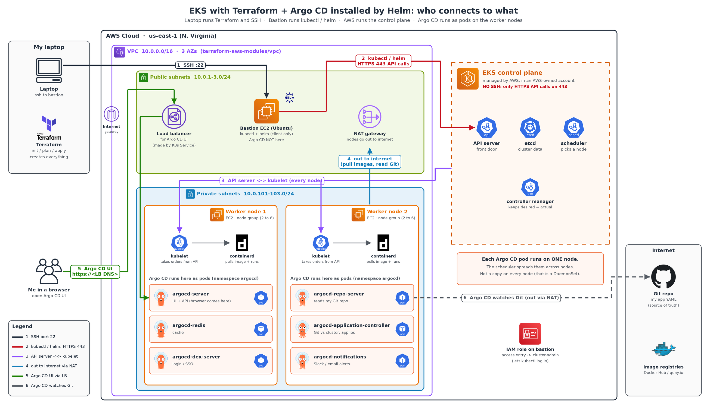

# Argo CD and GitOps: Install Argo CD with Helm on EKS

[← Kubernetes from scratch](../README.md)

> **In short:** **Argo CD** is a **GitOps** tool: Git is the single source of truth, and Argo CD runs inside the cluster and keeps it the same as the YAML in Git. We install it with **Helm** on our EKS cluster and open its dashboard through a load balancer.

## Table of Contents

1. [Install Argo CD with Helm](#1-install-argo-cd-with-helm)
2. [Commands](#2-commands)
3. [Interview Questions](#3-interview-questions)

---

> **Before you start:** an EKS cluster ([03](../03-eks-cluster-with-terraform/README.md)) and Helm on the bastion ([04](../04-helm/README.md)).

## 1. Install Argo CD with Helm

**Definition:** **Argo CD** is a **GitOps** tool for Kubernetes. It watches a Git repo and keeps the cluster the same as what is in Git.

**GitOps** = Git is the single source of truth. You change YAML in Git → Argo CD sees it → applies it to the cluster.

```
Developer ──push YAML──► Git repo ◄──watches── Argo CD (in cluster) ──applies──► Pods
```

### Helm vs Argo CD: what is installed where?

> **Helm is on the bastion. Argo CD is inside the cluster.** We do **not** install Argo CD on the bastion.

| Tool | Installed where | Who installs it |
|---|---|---|
| **Helm** | 🖥️ **Bastion** | Already installed by the bootstrap script when the bastion starts. Nothing to do |
| **kubectl** | 🖥️ **Bastion** | Same, already installed |
| **Argo CD** | ☸️ **Inside the EKS cluster**, as pods on the **worker nodes** | Me, by running `helm install` **from** the bastion |

**Think of it like an app store:**

1. **Helm** = the app store program. It sits on the **bastion**.
2. I type `helm install argocd ...` on the **bastion**.
3. Helm sends the Argo CD YAML files to the cluster's **API server** (HTTPS 443).
4. Argo CD gets **installed in the cluster** and **runs on the worker nodes as pods**, **not on the bastion**.

```
🖥️ Bastion                         ☸️ EKS cluster
┌──────────────┐   helm install   ┌───────────────────────────────┐
│ helm     ✅   │ ───────────────► │ Worker nodes                  │
│ kubectl  ✅   │   (HTTPS 443)    │   argocd-server pod       ✅   │
│ argocd   ❌   │                  │   argocd-repo-server pod  ✅   │
└──────────────┘                  │   argocd-controller pod   ✅   │
                                  └───────────────────────────────┘
```

**Proof (run on 🖥️ bastion):**

```bash
kubectl get pods -n argocd -o wide   # NODE column = worker node names, not the bastion
```

### Is Argo CD installed on every worker node?



**No.** Argo CD is a group of **pods** (Deployments + one StatefulSet), usually **1 copy of each** by default. The **scheduler** places each pod on **one** worker node that has free CPU/RAM. So the pods are **spread across** the nodes, not copied to every node.

| Argo CD pod | Job | Copies (default) |
|---|---|---|
| `argocd-server` | UI + API (what I open in the browser) | 1 |
| `argocd-repo-server` | Reads my Git repo, builds the YAML | 1 |
| `argocd-application-controller` | Compares Git vs cluster, applies changes (StatefulSet) | 1 |
| `argocd-applicationset-controller` | Creates many Argo CD apps from one template | 1 |
| `argocd-redis` | Cache | 1 |
| `argocd-dex-server` | Login with GitHub / SSO | 1 |
| `argocd-notifications-controller` | Sends Slack / email alerts | 1 |

Example with my 2 worker nodes:

```
Worker node 1                        Worker node 2
┌───────────────────────────┐       ┌───────────────────────────┐
│ argocd-server             │       │ argocd-repo-server        │
│ argocd-redis              │       │ argocd-application-ctrl   │
│ argocd-dex-server         │       │ argocd-applicationset-ctrl│
│                           │       │ argocd-notifications-ctrl │
└───────────────────────────┘       └───────────────────────────┘
        (scheduler decides; your layout may be different)
```

| Question | Answer |
|---|---|
| Who decides which node? | The **scheduler** in the control plane |
| What if a node dies? | Its Argo CD pods are **recreated on the other node** |
| Something that runs on **every** node? | That's a **DaemonSet** (e.g. `kube-proxy`, `aws-node`). Argo CD is **not** a DaemonSet |
| Production (high availability)? | Run **2+ copies** of each pod (Helm values, e.g. `server.replicas=2`) so they sit on different nodes |

### Why are different Argo CD pods on node 1 and node 2?

**Argo CD is not one program.** It is about **7 small programs (microservices)**, each in its **own pod** with its own job. Same idea as **RoboShop**: `catalogue`, `cart`, `user`, `payment` were separate services.

| Argo CD pod | Job |
|---|---|
| `argocd-server` | Website (UI) + API I open in the browser |
| `argocd-repo-server` | Reads my Git repo, builds the YAML |
| `argocd-application-controller` | Compares Git vs cluster, applies changes |
| `argocd-redis` | Cache (fast memory) |
| `argocd-dex-server` | Login (GitHub / SSO) |
| `argocd-notifications-controller` | Slack / email alerts |
| `argocd-applicationset-controller` | Creates many apps from one template |

**Step by step:**

1. Helm creates **7 different pods**, 1 copy each.
2. The **scheduler** places **each pod on one node** (checks free CPU/RAM, spreads them out).
3. So node 1 gets some pods, node 2 gets the others → **different pods on each node**.
4. **All 7 together = one working Argo CD.**

> The split in the diagram is **only an example**. My real cluster may differ. Check with `kubectl get pods -n argocd -o wide` (NODE column).

### What if I have 20 worker nodes?

**No problem.** Argo CD still has only 7 pods, so at most 7 nodes get one. The other 13 nodes have **no** Argo CD pod, and that is **normal**. Argo CD still deploys apps to **all 20 nodes**.

```
Node 1: argocd-server          Node 8 ... Node 20:
Node 2: argocd-repo-server       no Argo CD pods → fine ✅
Node 3: argocd-controller
...
```

**Why it works from any node (cluster level):**

| # | Reason |
|---|---|
| 1 | **Argo CD talks to the API server, not to nodes.** It sends YAML to the API server (like I do with `kubectl`); the **scheduler** picks a node (any of the 20) for the app pods |
| 2 | **Pods reach each other across nodes.** `argocd-server` (node 1) calls `argocd-repo-server` (node 2) by **Service name**, not IP. The **VPC CNI** gives every pod a VPC IP, so any pod can reach any pod. Same as RoboShop: `cart` reached `catalogue` by DNS name |
| 3 | **The load balancer finds the UI pod** wherever `argocd-server` runs |

```
Argo CD (on any node) ──► API server ──► scheduler picks any node ──► kubelet runs the app pod
```

| Question | Answer |
|---|---|
| Must Argo CD be on a particular node? | ❌ No, any node works |
| Must it be on all nodes? | ❌ No. "One per node" = **DaemonSet** (`kube-proxy`, log agents) |
| Does it manage the whole cluster? | ✅ Yes, through the API server |
| A node with Argo CD pods dies? | Pods are **recreated on another node** |

**When companies do choose the node (real time):**

| Want | How |
|---|---|
| Keep Argo CD on separate "tools" nodes | `nodeSelector` / node affinity (e.g. node group labeled `role=tools`) |
| No downtime if a node dies (HA) | **2+ copies** (`server.replicas=2`) + **pod anti-affinity** so copies land on **different** nodes |

> **Interview one-liner:** Argo CD is a set of microservice pods that can run on any node. It manages the whole cluster through the API server, and the scheduler places app pods on any node. Pods talk across nodes by Service name. For HA, run 2+ replicas with anti-affinity.

### Self-managed cluster vs EKS: where does Helm get installed?

On a self-managed cluster (built with kubeadm) you often log in to the control-plane machine and run `curl ... get-helm-4 | ./get_helm.sh` at `root@controlplane`. That does **not** install Helm *into* the cluster. It installs the **`helm` program** on the machine you are typing on.

| | Self-managed (kubeadm) | My EKS setup |
|---|---|---|
| Cluster type | Self-managed (kubeadm): I get a shell **on the control-plane machine** | AWS-managed: control plane is **hidden**, no login |
| Where I type commands | `root@controlplane` | `ubuntu@bastion` |
| Where `kubectl` + `helm` are installed | On the control-plane node's Linux | On the **bastion** |
| What `helm` does | Sends YAML to the API server | Same |

```
Self-managed: root@controlplane ── helm ──► API server (same machine) ──► worker node pods
EKS:          ubuntu@bastion    ── helm ──► API server (AWS-managed)  ──► worker node pods
```

> **Rule:** Helm goes on **whatever machine I type commands on** (like `kubectl`). In EKS I can't get into the control plane, so the **bastion** plays that role.

**Install Helm by hand:**

```bash
# 🖥️ on the machine where I run kubectl (bastion in EKS)
curl -fsSL -o get_helm.sh https://raw.githubusercontent.com/helm/helm/main/scripts/get-helm-4
chmod 700 get_helm.sh
./get_helm.sh            # installs /usr/local/bin/helm
helm version
```

> My bastion bootstrap script already does this automatically (it uses `get-helm-3` → Helm 3; the command above gives Helm 4). Both work for Argo CD with the same commands.

### Do I need kubeadm on the bastion?

**No.** The bastion needs only **kubectl, helm and AWS CLI**, and the bootstrap script installs them automatically.

**kubeadm** = a tool to **build your own cluster by hand** (`kubeadm init` makes a control plane, `kubeadm join` adds worker nodes). Self-managed clusters are built this way. In EKS, **AWS builds the control plane** and **Terraform's node group** creates the worker nodes, so kubeadm has no job.

| Tool | On bastion? | Why |
|---|---|---|
| **kubectl** | ✅ auto-installed | Sends commands to the EKS API server |
| **helm** | ✅ auto-installed | Installs apps like Argo CD |
| **AWS CLI** | ✅ auto-installed | `aws eks update-kubeconfig` logs kubectl in to EKS |
| **eksctl** | Optional, auto-installed | Extra EKS helper |
| **kubeadm** | ❌ No | Only for self-built clusters |

| | Self-managed (kubeadm) | EKS (my setup) |
|---|---|---|
| Who builds the control plane | Me: `kubeadm init` | AWS |
| Who adds worker nodes | Me: `kubeadm join` | Terraform node group |
| Tools on my admin machine | kubeadm, kubelet, kubectl, helm | kubectl, helm, AWS CLI |

```bash
# 🖥️ BASTION: check tools
kubectl version --client
helm version
aws --version
```

### Common questions

| Question | Answer |
|---|---|
| Where do I run the `helm` and `kubectl` commands? | 🖥️ **Bastion host** |
| Do I install Helm on the bastion? | Already done: the bootstrap script installs it. Check with `helm version` |
| Do I install Helm on the cluster too? | ❌ **No.** Helm is only a **client tool** (like `kubectl`). Nothing Helm-related runs in the cluster |
| Where does **Argo CD** get installed? | **Inside the Kubernetes cluster**, as pods in the `argocd` namespace |
| On the control plane or worker nodes? | Argo CD **pods run on the worker nodes**. The control plane only stores their records in etcd and schedules them |
| Is Argo CD installed on the bastion? | ❌ No. The bastion only **sends** the install command |
| How do I open the Argo CD UI? | Browser → **AWS load balancer** (public subnet) → `argocd-server` pod on a worker node |

### How `helm install` works, step by step

| Step | Where | What happens |
|---|---|---|
| 1 | 🖥️ Bastion | I run `helm install argocd argo/argo-cd ...` |
| 2 | 🖥️ Bastion | Helm **downloads the chart** from the Argo repo and fills the templates with values → many K8s YAMLs (Deployments, Services, Secrets, RBAC, CRDs) |
| 3 | Bastion → Control plane | Helm sends those YAMLs to the **API server** over **HTTPS (443)**, the same way `kubectl` does (uses `~/.kube/config`) |
| 4 | Control plane | API server saves them in **etcd**; **scheduler** picks worker nodes for the Argo CD pods |
| 5 | Worker nodes | **kubelet** tells **containerd** to **pull the Argo CD images** and start the pods |
| 6 | AWS | The `LoadBalancer` Service makes AWS create a **load balancer** in the public subnets |
| 7 | 💻 My browser | Open the LB address → reaches the `argocd-server` pod → Argo CD UI |

```
 🖥️ Bastion                     Control plane (AWS)              Worker nodes (my VPC, private)
┌───────────────┐  HTTPS 443  ┌──────────────────────┐        ┌──────────────────────────────────┐
│ helm install  │ ──────────► │ API server → etcd    │ ─────► │ namespace: argocd                │
│ (client only) │             │ scheduler            │        │  argocd-server  (UI + API)       │
└───────────────┘             └──────────────────────┘        │  argocd-repo-server (reads Git)  │
                                                              │  argocd-application-controller   │
                                                              │  argocd-redis, dex ...           │
💻 Browser ──► AWS Load Balancer (public subnet) ───────────► │  └─ argocd-server pod            │
                                                              └──────────────────────────────────┘
```

> **Simple:** Helm lives on the bastion and only sends orders. Argo CD lives **inside the cluster**, as pods on the **worker nodes**.

### Steps

> Step 0 starts on your **💻 laptop** (to SSH in). **Every step after that runs on the 🖥️ bastion.**

> **Shortcut (scripted):** my repo has all these steps as scripts: [k8s-eks-projects/03-argocd](https://github.com/Abhignadumpala/k8s-eks-projects/tree/main/03-argocd). On the bastion: `git clone https://github.com/Abhignadumpala/k8s-eks-projects.git && cd k8s-eks-projects/03-argocd && bash install.sh`. Remove with `bash uninstall.sh` before `terraform destroy`.

**Step 0 — 💻 LAPTOP → 🖥️ BASTION: SSH in and check tools**

```bash
# 💻 LAPTOP
ssh -i ~/.ssh/abhigna-eks-key.pem ubuntu@$(terraform output -raw bastion_public_ip)

# 🖥️ BASTION
helm version                # Helm is installed
kubectl get nodes           # cluster reachable, 2 nodes Ready
```

**Step 1 — 🖥️ run on BASTION: add the Argo Helm repo** (like adding a yum/apt repo)

```bash
# 🖥️ BASTION
helm repo add argo https://argoproj.github.io/argo-helm
helm repo update
helm search repo argo/argo-cd          # see chart versions
```

**Step 2 — 🖥️ run on BASTION: install Argo CD into the cluster**

```bash
# 🖥️ BASTION
helm install argocd argo/argo-cd \
  --namespace argocd \
  --create-namespace \
  --set server.service.type=LoadBalancer
```

| Part | Meaning |
|---|---|
| `argocd` | Release name (my name for this install) |
| `argo/argo-cd` | Repo `argo` / chart `argo-cd` |
| `--namespace argocd --create-namespace` | Put everything in its own namespace |
| `--set server.service.type=LoadBalancer` | Change one value: create an AWS load balancer so I can open the UI |

**Step 3 — 🖥️ run on BASTION: check it is running in the cluster**

```bash
# 🖥️ BASTION
helm list -n argocd                       # release status: deployed
kubectl get pods -n argocd -o wide        # all Running; NODE column = which worker node
kubectl get svc -n argocd argocd-server   # EXTERNAL-IP = load balancer DNS
```

> `-o wide` shows the **NODE** column, proof that Argo CD pods run on the **worker nodes**.

**Why is the Argo CD service type LoadBalancer?**

In EKS, a Service of type **LoadBalancer** makes AWS create a real **load balancer** with a public DNS name. That lets you open the Argo CD **dashboard from the internet** (your laptop browser).

| Service type | Who can reach Argo CD UI? |
|---|---|
| `ClusterIP` (chart default) | Only inside the cluster → need port-forward |
| `NodePort` | Node IP + port (our nodes are private, so not from laptop) |
| **`LoadBalancer`** (we use) | **Anyone on the internet** via the LB DNS |

```
💻 Laptop browser ──► AWS Load Balancer (public DNS) ──► argocd-server Service ──► argocd-server pod (worker node)
```

> ⚠️ Public dashboard = anyone can reach the login page. Use a strong password, and in real jobs restrict it (security group / internal LB / ingress with HTTPS).

**Installed it as ClusterIP by mistake? Change it with `kubectl patch`:**

```bash
# 🖥️ BASTION
kubectl patch svc argocd-server -n argocd -p '{"spec": {"type": "LoadBalancer"}}'
kubectl get svc argocd-server -n argocd     # EXTERNAL-IP shows the LB DNS after 1-2 min
```

### What is `kubectl patch`? (⭐ interview)

**Definition:** `kubectl patch` **changes one property of an existing object** (Service, Deployment, etc.) **in place**, without deleting it and without editing the whole YAML.

```bash
kubectl patch <type> <name> -n <namespace> -p '<only the field to change>'
```

| Example | What it changes |
|---|---|
| `kubectl patch svc argocd-server -n argocd -p '{"spec":{"type":"LoadBalancer"}}'` | Service type ClusterIP → LoadBalancer |
| `kubectl patch deployment nginx -p '{"spec":{"replicas":3}}'` | Replicas → 3 |

**patch vs edit vs apply:**

| Command | How | Use when |
|---|---|---|
| `kubectl patch` | Send **only the changed field** in one command | Quick one-field change, scripts |
| `kubectl edit` | Opens the full live YAML in an editor (vi) | Look and change by hand |
| `kubectl apply -f file.yaml` | Apply the full YAML file | Normal way, file kept in Git |

> **Helm note:** Argo CD was installed by Helm. A patch changes only the live cluster, and the next `helm upgrade` can undo it. The permanent fix is `helm upgrade argocd argo/argo-cd -n argocd --set server.service.type=LoadBalancer` (or `values.yaml`).

> **Interview one-liner:** `kubectl patch` updates a specific field of an existing Kubernetes object in place, e.g. changing a Service from ClusterIP to LoadBalancer, without deleting or re-applying the whole YAML.

**Step 4 — 🖥️ run on BASTION: get the admin password**

```bash
# 🖥️ BASTION
kubectl -n argocd get secret argocd-initial-admin-secret \
  -o jsonpath="{.data.password}" | base64 -d; echo
```

**Step 5 — 💻 on LAPTOP browser: open the Argo CD UI**

- 💻 **Laptop browser:** open `https://<EXTERNAL-IP from step 3>` (wait 2–3 min for the LB DNS).
- Accept the self-signed certificate warning.
- Login: user **admin**, password from step 4.

> **No load balancer?** Port-forward through the bastion with an SSH tunnel:
> ```bash
> # 🖥️ BASTION
> kubectl port-forward svc/argocd-server -n argocd 8080:443
> # 💻 LAPTOP (new terminal)
> ssh -i ~/.ssh/abhigna-eks-key.pem -L 8080:localhost:8080 ubuntu@<bastion-ip>
> ```
> Then open `https://localhost:8080` on the laptop.

**Upgrade / remove — 🖥️ run on BASTION**

```bash
# 🖥️ BASTION
helm upgrade argocd argo/argo-cd -n argocd --set server.service.type=LoadBalancer
helm history argocd -n argocd
helm rollback argocd 1 -n argocd
helm uninstall argocd -n argocd       # removes Argo CD pods and the LB
```

### Check a release and roll back (helm list, kubectl get pods, helm rollback)

All commands run on the **🖥️ BASTION**.

**Important difference:**

| Command | Shows | Does NOT show |
|---|---|---|
| `helm list` | **Releases** (installed charts): name, revision, chart version, app version | Pods |
| `kubectl get pods` | **Pods** running in the cluster | Chart version / revision |

> One Helm **release** creates **many pods**. Argo CD = 1 release → ~7 pods. So use `helm list` for "which version is installed?" and `kubectl get pods` for "how many pods are running?"

**Step 1 — Which release and version is installed?**

```bash
# 🖥️ BASTION
helm list -n argocd        # releases in the argocd namespace
helm list -A               # releases in ALL namespaces
```

```
NAME    NAMESPACE  REVISION  STATUS    CHART           APP VERSION
argocd  argocd     2         deployed  argo-cd-8.x.x   v3.x.x
```

| Column | Meaning |
|---|---|
| `NAME` | Release name you gave in `helm install argocd ...` |
| `REVISION` | How many times it was installed/upgraded (1 = first install) |
| `STATUS` | `deployed` = working, `failed` = install/upgrade broke |
| `CHART` | Chart name + **chart version** (from `Chart.yaml` `version`) |
| `APP VERSION` | Version of **Argo CD itself** (from `Chart.yaml` `appVersion`) |

**Step 2 — Which pods are running?**

```bash
# 🖥️ BASTION
kubectl get pods -n argocd          # list the pods
kubectl get pods -n argocd -o wide  # + which worker node each pod is on
```

**Step 3 — See all revisions (history) before rolling back**

```bash
# 🖥️ BASTION
helm history argocd -n argocd
```

```
REVISION  STATUS      CHART          DESCRIPTION
1         superseded  argo-cd-8.x.x  Install complete
2         deployed    argo-cd-8.x.x  Upgrade complete
```

**Step 4 — Roll back to revision 1**

```bash
# 🖥️ BASTION
helm rollback argocd 1 -n argocd
#             ^^^^^^ ^
#             release revision number to go back to
```

**Step 5 — Check it worked**

```bash
# 🖥️ BASTION
helm history argocd -n argocd   # new row: revision 3 "Rollback to 1"
kubectl get pods -n argocd      # pods restart with the old settings
```

> **Rollback does not delete history.** Going back to revision 1 creates a **new revision 3** that is a copy of revision 1. Revision numbers only go up.

```
rev 1 (install) ──► rev 2 (upgrade, broken) ──► rev 3 (= copy of rev 1)
                                                  helm rollback argocd 1
```

> **Interview one-liner:** `helm list` shows releases with their revision, chart version and app version. `kubectl get pods` shows the pods the release created. `helm history` shows all revisions, and `helm rollback <release> <revision>` goes back to an old one, saved as a new revision.

---

## 2. Commands

| Command | Use |
|---|---|
| `helm install argocd argo/argo-cd -n argocd --create-namespace` | Install Argo CD with Helm |
| `kubectl get pods -n argocd` | Argo CD Pods (server, repo-server, controller…) |
| `kubectl get svc -n argocd` | Argo CD Services (find the server's EXTERNAL-IP) |
| `kubectl patch svc argocd-server -n argocd -p '{"spec":{"type":"LoadBalancer"}}'` | Expose the Argo CD UI with a load balancer |
| `kubectl get secret argocd-initial-admin-secret -n argocd -o jsonpath="{.data.password}" \| base64 -d` | Admin password |
| `helm uninstall argocd -n argocd` | Remove Argo CD (and its load balancer) |

---

## 3. Interview Questions

### ⭐ Very Important

**Q1. What is the `kubectl patch` command?**
It modifies a property of an existing object in place, without deleting it or re-applying the full YAML. Example: `kubectl patch svc argocd-server -n argocd -p '{"spec":{"type":"LoadBalancer"}}'` changes the Service type to LoadBalancer.

**Q2. Why is the Argo CD server Service type LoadBalancer in EKS?**
So AWS creates a load balancer with a public DNS name and we can open the Argo CD dashboard from the internet. The default ClusterIP is reachable only inside the cluster (port-forward needed).

### Other Questions

**Q1. What is Argo CD / GitOps?**
Argo CD is a GitOps tool: Git is the source of truth, and Argo CD keeps the cluster in sync with the YAML in Git.

**Q2. How do you get the Argo CD admin password?**
From the secret `argocd-initial-admin-secret` in the `argocd` namespace, base64-decoded.

**Q3. Where does Argo CD run?**
Inside the cluster, as pods in the `argocd` namespace on the worker nodes. The bastion only runs the `helm install` command.

**Q4. Is Argo CD installed on every worker node?**
No. It's a set of pods (1 copy each by default) that the scheduler spreads across nodes. Pods that run on every node are DaemonSets, like kube-proxy and aws-node.

**Q5. Why are different Argo CD pods on different nodes?**
Argo CD is ~7 microservices, each its own pod (1 copy by default). The scheduler puts each pod on one node, so they spread across nodes.

**Q6. With 20 nodes, does Argo CD need to be on every node?**
No. It runs on a few nodes and manages the whole cluster through the API server; the scheduler places app pods on any node. One-pod-per-node is a DaemonSet, which Argo CD is not.

---

**Source:** [Argo CD Helm chart](https://github.com/argoproj/argo-helm/tree/main/charts/argo-cd) · [Argo CD getting started](https://argo-cd.readthedocs.io/en/stable/getting_started/)
