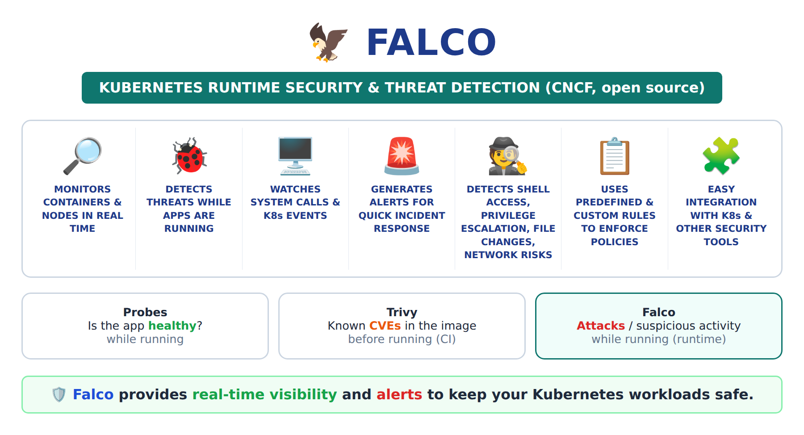

# Falco: Kubernetes Runtime Security and Threat Detection

[← Kubernetes from scratch](../README.md)

> **In short:** **Falco** watches every container and node **while they run** and sends an **alert** when something suspicious happens, like a shell opened inside a production container. It runs as a DaemonSet (one Pod per node) and is installed with Helm.

## Table of Contents

1. [Falco: Kubernetes runtime security](#1-falco-kubernetes-runtime-security)
2. [Commands](#2-commands)
3. [Interview Questions](#3-interview-questions)

---

> **Before you start:** an EKS cluster ([03](../03-eks-cluster-with-terraform/README.md)) and Helm ([04](../04-helm/README.md)).

## 1. Falco: Kubernetes runtime security

**Definition:** **Falco** is an open-source (CNCF) **runtime security and threat detection** tool for Kubernetes. It **monitors all containers and nodes in real time** and **sends alerts** when something suspicious or malicious happens.

> ⭐ **Falco provides real-time visibility and alerts to keep your Kubernetes workloads safe.**



**Why do we need it?** Probes check if the app is **healthy**. Nobody checks if someone is **attacking** it. Image scanning (Trivy) checks images **before** they run. Falco watches **while they run** ("runtime").

| Tool | Checks | When |
|---|---|---|
| Probes | Is the app healthy / ready? | While running |
| Trivy (image scan) | Known vulnerabilities in the image | **Before** running (build / CI) |
| **Falco** | **Suspicious activity / threats** | **While running** (runtime) |

### What Falco does

| # | Feature | Simple meaning |
|---|---|---|
| 1 | **Monitors containers & nodes in real time** | Watches every container and every worker node, all the time |
| 2 | **Detects threats while apps are running** | Finds attacks at runtime, not only at build time |
| 3 | **Watches system calls & Kubernetes events** | Sees every action: open file, run program, network connection, `kubectl` actions |
| 4 | **Generates alerts for quick incident response** | Sends an alert right away so the team can act |
| 5 | **Detects suspicious activities** | Shell access, privilege escalation, file changes, network risks |
| 6 | **Uses predefined & custom rules** | Ready-made rules + write your own to enforce policies |
| 7 | **Easy integration** | Works with K8s and sends alerts to Slack, email, SIEM, Prometheus, etc. |

### What it detects (examples)

| Suspicious activity | Example |
|---|---|
| **Shell access** | Someone runs `kubectl exec -it <pod> -- bash` into a production container |
| **Privilege escalation** | Process tries to become root / run privileged container |
| **File changes** | Writes to `/etc`, `/bin`, reads `/etc/shadow` (passwords) |
| **Network risks** | Container connects to an unknown IP / opens unexpected port (e.g. crypto miner) |
| **Unexpected programs** | Package manager (`apt`, `yum`) or `nc` run inside a running container |

### How it works, step by step

1. Falco runs as a **DaemonSet** → **one Falco pod on every worker node** (it must see every container on every node).
2. On each node, it reads **system calls** (what every process does) using an **eBPF** driver in the Linux kernel, plus **Kubernetes events**.
3. It compares each event with its **rules** (e.g. "shell started in a container").
4. A rule matches → Falco **generates an alert** (who, which pod, which command, when).
5. The alert goes to **logs** or, through **Falcosidekick**, to **Slack / email / SIEM** → team responds.

```
 Containers on node ──► system calls ──► Falco pod (DaemonSet, on every node)
                                              │  compare with rules
                                              ▼
                                       Rule matched? ──► ALERT 🚨 ──► logs / Slack / email
```

> Falco **detects and alerts**. It does **not block** the action by itself. Blocking is done by other tools (e.g. admission policies, Kyverno/OPA).

### Install Falco with Helm (from Artifact Hub, Helm use case 2)

All commands on the **🖥️ bastion** (where kubectl is set up):

```bash
# 1. Add the official Falco chart repo (Verified Publisher: falcosecurity)
helm repo add falcosecurity https://falcosecurity.github.io/charts
helm repo update

# 2. Install Falco in its own namespace
helm install falco falcosecurity/falco -n falco --create-namespace

# 3. Check: one Falco pod per worker node (DaemonSet)
kubectl get pods -n falco -o wide
kubectl get daemonset -n falco
```

### Test: trigger an alert

```bash
# 1. Start a test pod
kubectl run nginx --image=nginx

# 2. Do something suspicious: open a shell inside the container
kubectl exec -it nginx -- bash
exit

# 3. Read Falco's alerts
kubectl logs -n falco -l app.kubernetes.io/name=falco -c falco | grep -i shell
```

Example alert:

```
Notice A shell was spawned in a container with an attached terminal
  (user=root ... container_name=nginx ... k8s.pod=nginx shell=bash ...)
```

Falco saw `bash` start inside the `nginx` container → matched the built-in rule **"Terminal shell in container"** → alert 🚨.

**Clean up:**

```bash
kubectl delete pod nginx
helm uninstall falco -n falco
```

> **Interview one-liner:** Falco is a CNCF runtime security tool. It runs as a DaemonSet on every node, watches system calls and Kubernetes events with eBPF, matches them against rules, and sends real-time alerts for threats like shell access in a container, privilege escalation, sensitive file changes or unexpected network connections.

---

## 2. Commands

| Command | Use |
|---|---|
| `helm repo add falcosecurity https://falcosecurity.github.io/charts` | Add the official Falco chart repo |
| `helm install falco falcosecurity/falco -n falco --create-namespace` | Install Falco |
| `kubectl get daemonset -n falco` | One Falco Pod per node |
| `kubectl logs -n falco -l app.kubernetes.io/name=falco -c falco` | Read Falco's alerts |
| `helm uninstall falco -n falco` | Remove Falco |

---

## 3. Interview Questions

### ⭐ Very Important

**Q1. What is Falco?**
A Kubernetes runtime security and threat detection tool. It monitors all containers and nodes in real time, watches system calls and Kubernetes events, and sends alerts for suspicious or malicious activity (shell access, privilege escalation, file changes, network risks). Falco provides real-time visibility and alerts to keep Kubernetes workloads safe.

**Q2. How does Falco work?**
It runs as a DaemonSet (one pod per node), reads system calls with an eBPF driver, compares them with predefined and custom rules, and generates an alert when a rule matches. Alerts go to logs or to Slack/email/SIEM through Falcosidekick.

**Q3. Difference between Trivy and Falco?**
Trivy scans images for known vulnerabilities before they run (build/CI). Falco detects threats while containers are running (runtime). Falco alerts; it does not block.

---

**Source:** [Falco docs](https://falco.org/docs/) · [Falco Helm chart](https://github.com/falcosecurity/charts/tree/master/charts/falco)
