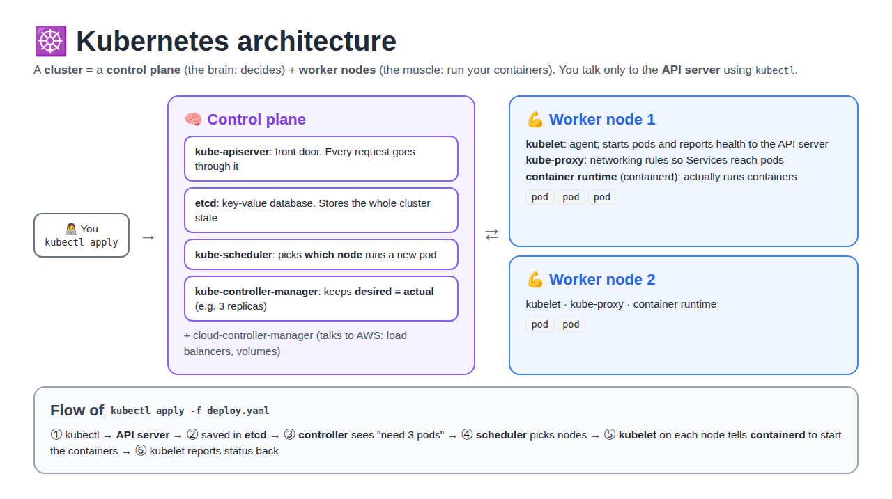

# Kubernetes from Scratch: From Pods to Production on EKS

Simple, step-by-step Kubernetes notes for beginners. Every topic starts with a **definition**, explains the idea with **diagrams and tables**, and ends with a **hands-on lab** on a real **Amazon EKS** cluster.



## About these notes

**Kubernetes** = an open-source platform that runs and manages containers across many machines: it places them on servers, restarts them when they crash, scales them and updates them with zero downtime. **Amazon EKS** = Kubernetes on AWS, where AWS runs the control plane and we run the worker nodes.

| # | Topic | What you learn | Lab |
|---|---|---|---|
| 1 | [Introduction and architecture](01-introduction-and-architecture/README.md) | what and why, real-time use (RoboShop), EKS cluster settings, control plane and worker node components | create an EKS cluster in the console |
| 2 | [Pods, Deployments and Jobs](02-pods-deployments-and-jobs/README.md) | Pod, ReplicaSet, Deployment, rolling update, rollback, init and sidecar containers, Job, CronJob | run, scale, update and roll back apps |
| 3 | [EKS cluster with Terraform](03-eks-cluster-with-terraform/README.md) | VPC, EKS and node group with Terraform modules, bastion, who creates what | `terraform apply` a full EKS cluster |
| 4 | [Helm](04-helm/README.md) | charts, releases, values, Artifact Hub, upgrade and rollback, Helm vs Ansible | install a chart from Artifact Hub |
| 5 | [Namespaces and resource limits](05-namespaces-and-resource-limits/README.md) | namespaces, requests and limits, QoS, ResourceQuota, LimitRange | see an OOMKilled Pod, add a quota |
| 6 | [ConfigMaps and Secrets](06-configmaps-and-secrets/README.md) | config outside the image, env vs files, base64, AWS Secrets Manager | config for a RoboShop-style service |
| 7 | [Probes](07-probes/README.md) | startup, liveness, readiness, HTTP / TCP / exec checks, CrashLoopBackOff | break a probe and fix it |
| 8 | [Services](08-services/README.md) | ClusterIP, NodePort, LoadBalancer, what production uses, traffic flow | expose one app 4 ways |
| 9 | [DNS and Network Policies](09-dns-and-network-policy/README.md) | CNI, CoreDNS, nslookup, Network Policy, default deny | lock down frontend → backend → db |
| 10 | [Ingress](10-ingress/README.md) | why Ingress, controllers, request flow, host and path rules, HTTPS, security | two apps behind one ALB |
| 11 | [Storage: volumes, PV, PVC](11-storage-volumes-pv-pvc/README.md) | volume types, PV, PVC, StorageClass, EBS CSI driver, EBS vs EFS | data that survives a Pod restart |
| 12 | [StatefulSet and DaemonSet](12-statefulset-and-daemonset/README.md) | stateful apps, headless Service, per-Pod disks, one Pod per node | StatefulSet with EBS + a DaemonSet |
| 13 | [Scheduling](13-scheduling-taints-and-affinity/README.md) | nodeSelector, node affinity, taints and tolerations, dedicated nodes, Pod affinity, topology spread | place Pods on an "AI node" |
| 14 | [Autoscaling](14-autoscaling/README.md) | Metrics Server, HPA, node groups, Cluster Autoscaler, Karpenter, Auto Mode | HPA under load, add a node |
| 15 | [RBAC and ServiceAccounts](15-rbac-and-service-accounts/README.md) | authentication vs authorization, Role, ClusterRole, bindings, Pod Identity / IRSA | a read-only ServiceAccount |
| 16 | [Argo CD and GitOps](16-argocd-gitops/README.md) | GitOps, Argo CD install with Helm, dashboard, Helm rollback | install Argo CD on EKS |
| 17 | [Falco runtime security](17-falco-runtime-security/README.md) | runtime threat detection, how Falco works, alerts | catch a shell in a container |

## How to use these notes

Read the topics **in order**: each one builds on the one before.

Every topic follows the same structure:

| Section | What's inside |
|---|---|
| **In short** | the whole topic in a few lines |
| **Part 1: Concepts** | definitions, diagrams, tables, examples (nothing to run) |
| **Part 2: Lab** | step by step, one command per box, with **What it does** and **Expected** |
| **What I learned** | the short summary |
| **Interview Questions** | ⭐ very important ones first, then other questions |

## Lab setup

All labs run on an **EKS cluster** built with Terraform ([topic 3](03-eks-cluster-with-terraform/README.md)), and every command runs from a **bastion** EC2 with `kubectl`, `helm` and the AWS CLI installed.

```
 Laptop ──SSH──► Bastion (kubectl, helm, aws) ──HTTPS 443──► EKS API server ──► worker nodes (private subnets)
```

> 💰 EKS, NAT gateway, EC2 and load balancers cost money every hour. Run `terraform destroy` when you finish a lab, after deleting load balancers and PVCs.

**Runnable code** (Terraform, Helm, Argo CD, manifests): [k8s-eks-projects](https://github.com/Abhignadumpala/k8s-eks-projects)
